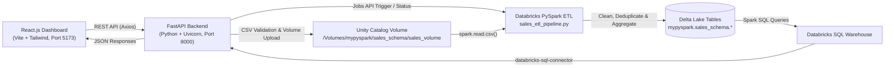
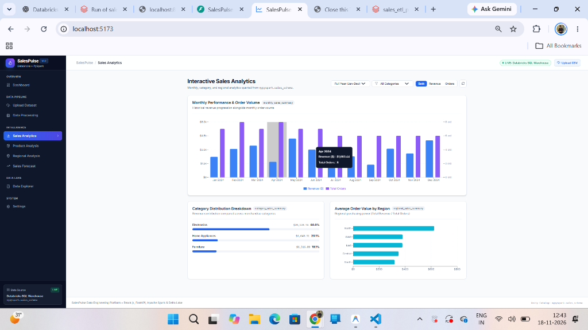
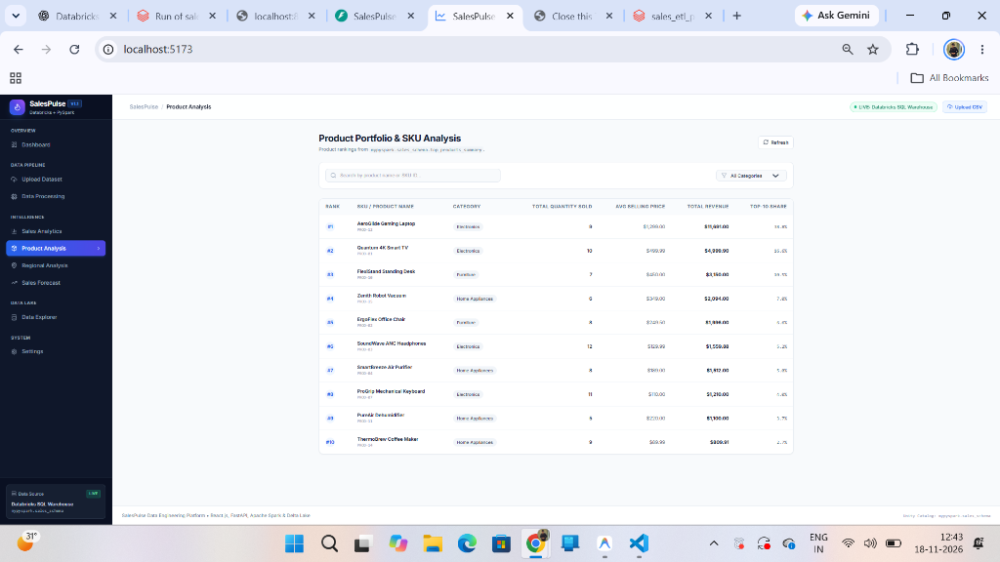
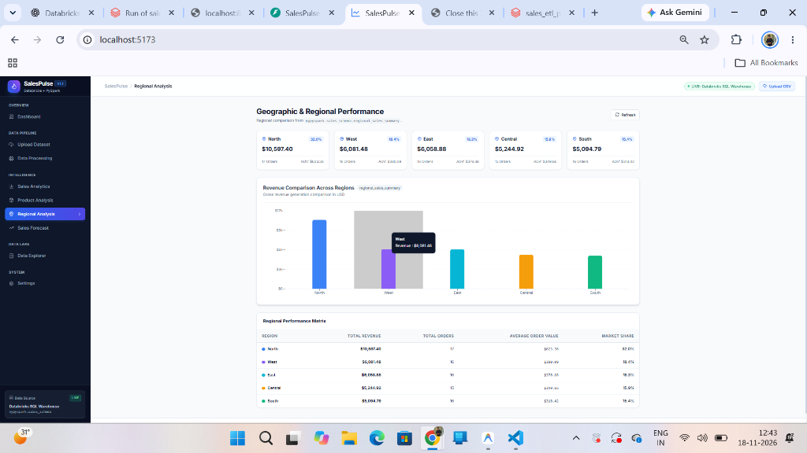
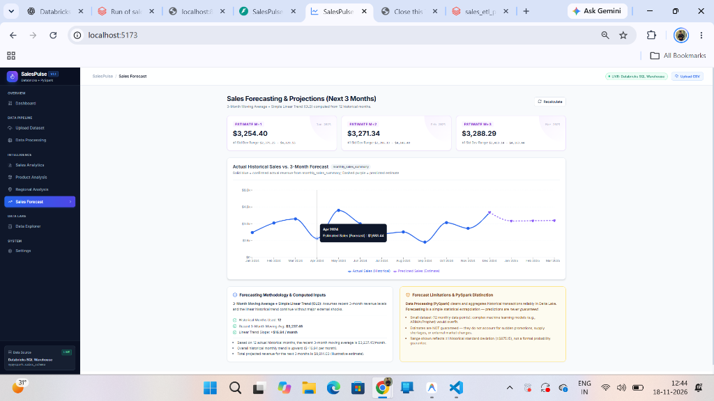
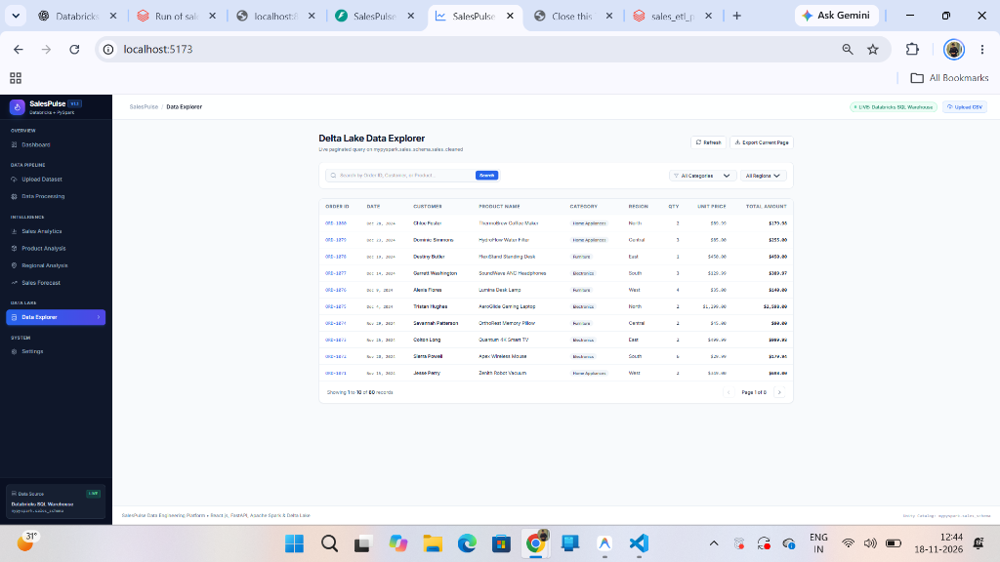
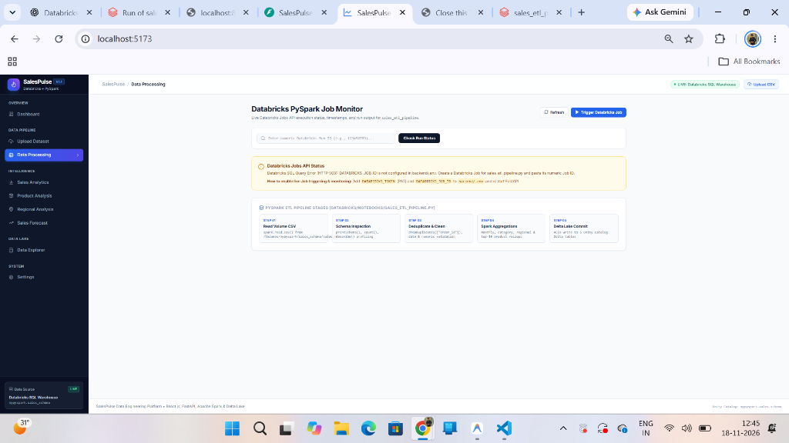

# SalesPulse – Sales Analytics & Forecasting Platform

A beginner-friendly, industry-standard **Data Engineering + Full-Stack Analytics** portfolio project built with **Databricks, PySpark, Delta Lake, Unity Catalog, FastAPI, and React.js**.

---

## 1. Project Overview

SalesPulse takes raw transactional sales CSV data, validates and cleans it with **Apache Spark (PySpark)** in **Databricks**, stores clean & aggregated datasets as **ACID Delta Lake tables** in **Unity Catalog (`mypyspark.sales_schema`)**, queries those tables via a **Databricks SQL Warehouse** through **FastAPI**, and presents KPIs, interactive charts, a 3-month explainable sales forecast, and a paginated Data Explorer in **React.js**.

---

## 2. System Architecture



---

## 3. Technology Stack

| Layer | Technologies |
| :--- | :--- |
| **Frontend** | React 18, Vite (Port `5173`), Tailwind CSS, Recharts, Lucide Icons, Axios |
| **Backend** | Python 3.11, FastAPI, Uvicorn (Port `8000`), Pydantic, Pandas (CSV validation) |
| **Data Engineering** | Databricks, PySpark, Spark SQL, Delta Lake, Unity Catalog, Volumes, Jobs API, SQL Warehouse |
| **Connectors** | `databricks-sql-connector`, `databricks-sdk`, `python-dotenv` |

---

## 4. Project Folder Structure

```
PySparc_Sales/
├── frontend/                              # React + Vite Dashboard (Port 5173)
│   ├── src/
│   │   ├── components/
│   │   │   ├── KPICard.jsx                # Reusable KPI summary card
│   │   │   ├── ChartCard.jsx              # Reusable chart wrapper
│   │   │   ├── StatusBadge.jsx            # Job status badge
│   │   │   └── ErrorBanner.jsx            # Honest error banner with Retry & Demo option
│   │   ├── layouts/
│   │   │   └── MainLayout.jsx             # Dark navy sidebar & live/demo status header
│   │   ├── pages/
│   │   │   ├── DashboardPage.jsx          # 6 KPIs, trends, category/region charts, top SKUs
│   │   │   ├── UploadPage.jsx             # CSV validation, Volume upload & Job trigger
│   │   │   ├── DataProcessingPage.jsx     # Live Databricks Jobs API status & logs
│   │   │   ├── SalesAnalyticsPage.jsx     # Interactive filters & multi-metric charts
│   │   │   ├── ProductAnalysisPage.jsx    # Top-10 SKU rankings & search
│   │   │   ├── RegionalAnalysisPage.jsx   # Regional revenue & AOV comparison
│   │   │   ├── SalesForecastPage.jsx      # Explainable 3-month Moving Avg + Linear Trend
│   │   │   ├── DataExplorerPage.jsx       # Paginated, searchable Delta Lake table viewer
│   │   │   └── SettingsPage.jsx           # Active non-secret config & Live/Demo switch
│   │   ├── services/
│   │   │   ├── api.js                     # Unified Axios API client (Live + explicit Demo)
│   │   │   ├── analytics.js               # Convenience re-exports of analytics calls
│   │   │   └── sampleData.js              # Verified sample CSV metrics for offline Demo Mode
│   │   └── utils/formatters.js            # Currency, number & date formatting helpers
│   ├── vite.config.js                     # Port 5173 + /api proxy -> http://localhost:8000
│   └── package.json
│
├── backend/                               # FastAPI Backend (Port 8000)
│   ├── app/
│   │   ├── config/settings.py             # Loads backend/.env safely (never exposes secrets)
│   │   ├── schemas/sales.py               # Pydantic request & response models
│   │   ├── services/
│   │   │   ├── databricks_service.py      # SQL Warehouse, Volume Upload & Jobs API
│   │   │   ├── etl_validator.py           # 11-column CSV schema, duplicate & type validator
│   │   │   ├── forecast_service.py        # 3-month Moving Average + OLS Linear Trend math
│   │   │   └── demo_service.py            # Computes exact Demo Mode stats from sample_sales.csv
│   │   ├── routes/
│   │   │   ├── analytics.py               # /dashboard/summary, /analytics/*, /forecast, /data
│   │   │   ├── upload.py                  # /upload/validate, /upload
│   │   │   └── jobs.py                    # /process, /jobs, /jobs/{run_id}
│   │   └── main.py                        # FastAPI app, CORS, /api/health, /api/config/status
│   ├── test_local.py                      # Automated local backend & endpoint test suite
│   ├── requirements.txt
│   └── .env.example                       # Sanitized environment template (no secrets)
│
├── databricks/
│   ├── notebooks/
│   │   ├── sales_etl_pipeline.py          # PySpark ETL notebook
│   │   └── sales_analytics.sql            # Spark SQL verification & BI queries
│   └── README.md                          # Databricks & Unity Catalog setup instructions
│
├── data/
│   └── sample_sales.csv                   # 82 raw rows (80 unique + 2 duplicate orders)
│
├── SALESPULSE_COMPLETION_REPORT.md        # Detailed implementation & testing report
├── .gitignore                             # Excludes .env, tokens, venv, node_modules, dist
└── README.md
```

---

## 5. Unity Catalog Delta Lake Tables (`mypyspark.sales_schema`)

| Table Name | Layer | Verified Rows (Sample CSV) | Purpose |
| :--- | :---: | :---: | :--- |
| `sales_cleaned` | Silver | `80` | Deduplicated, schema-validated transactional orders (2 duplicates removed from 82 raw rows) |
| `monthly_sales_summary` | Gold | `12` | Monthly revenue timeline (`year`, `month`, `total_revenue`) |
| `category_sales_summary` | Gold | `3` | Revenue & order share by product category |
| `regional_sales_summary` | Gold | `5` | Regional revenue & average order value comparison |
| `top_products_summary` | Gold | `10` | Top 10 revenue-generating products |

---

## 6. Environment Configuration (`backend/.env`)

Copy `backend/.env.example` to `backend/.env` and fill in your workspace details (**never commit `backend/.env`**):

```env
DATABRICKS_SERVER_HOSTNAME=your-workspace-id.cloud.databricks.com
DATABRICKS_HOST=https://your-workspace-id.cloud.databricks.com
DATABRICKS_WAREHOUSE_ID=your_sql_warehouse_id
DATABRICKS_HTTP_PATH=/sql/1.0/warehouses/your_sql_warehouse_id

# Leave empty to use browser OAuth for SQL Warehouse queries,
# OR add a Personal Access Token (PAT) to enable Volume Upload & Jobs API.
DATABRICKS_TOKEN=

# Optional numeric Databricks Job ID for automated PySpark ETL triggering
DATABRICKS_JOB_ID=

DATABRICKS_CATALOG=mypyspark
DATABRICKS_SCHEMA=sales_schema
DATABRICKS_VOLUME=sales_volume

PORT=8000
ENVIRONMENT=development
```

See [`databricks/README.md`](databricks/README.md) for step-by-step Databricks setup instructions.

---

## 7. Running Locally in VS Code (Windows)

### Step 1: Start Databricks SQL Warehouse
In Databricks $\rightarrow$ **SQL Warehouses** $\rightarrow$ **Serverless Starter Warehouse** $\rightarrow$ click **▶ Start**.

### Step 2: Run FastAPI Backend (Terminal 1 — Port `8000`)
```powershell
cd backend
.\venv\Scripts\activate
pip install -r requirements.txt
uvicorn app.main:app --reload --port 8000
```
* **API Root:** `http://localhost:8000`
* **Swagger Docs:** `http://localhost:8000/docs`
* **Health Check:** `http://localhost:8000/api/health`

*(If using OAuth without a PAT, a browser tab will open once on the first Databricks query—sign in and close the tab when prompted.)*

### Step 3: Run React Frontend (Terminal 2 — Port `5173`)
```powershell
cd frontend
npm install
npm run dev
```
* **Dashboard URL:** `http://localhost:5173`

---

## 8. API Endpoints Reference

| Method | Endpoint | Description |
| :--- | :--- | :--- |
| `GET` | `/` | Backend metadata & target Unity Catalog schema |
| `GET` | `/api/health` | FastAPI & live Databricks SQL Warehouse connectivity test |
| `GET` | `/api/config/status` | Active non-secret Databricks settings for the Settings UI |
| `GET` | `/api/dashboard/summary` | Total revenue, orders, products, customers, AOV & H2/H1 delta |
| `GET` | `/api/analytics/monthly-sales` | Monthly sales timeline from `monthly_sales_summary` |
| `GET` | `/api/analytics/category-sales` | Revenue share by category from `category_sales_summary` |
| `GET` | `/api/analytics/regional-sales` | Regional revenue & AOV from `regional_sales_summary` |
| `GET` | `/api/analytics/top-products` | Top 10 products from `top_products_summary` |
| `GET` | `/api/forecast` | Explainable 3-month forecast computed from live monthly sales |
| `GET` | `/api/data` | Paginated, searchable, filtered rows from `sales_cleaned` |
| `POST` | `/api/upload/validate` | Validates CSV schema, duplicates, nulls, dates & numerics |
| `POST` | `/api/upload` | Validates CSV and uploads to Unity Catalog Volume (requires PAT) |
| `POST` | `/api/process` | Triggers Databricks PySpark ETL Job (requires PAT + Job ID) |
| `GET` | `/api/jobs` | Lists recent genuine Databricks Job runs |
| `GET` | `/api/jobs/{run_id}` | Retrieves real status, timestamps & logs for a numeric Run ID |

*(All read-only analytics endpoints also accept `?mode=demo` for explicit offline preview using `data/sample_sales.csv`.)*

---

## 9. CSV Upload Requirements

Uploaded `.csv` files must contain these 11 required columns:
`order_id`, `order_date`, `customer_id`, `customer_name`, `product_id`, `product_name`, `category`, `region`, `quantity`, `unit_price`, `sales_amount`.

---

## 10. Forecast Methodology & Limitations

* **Method:** 3-Month Moving Average + Simple Linear Regression Trend (Ordinary Least Squares slope) computed dynamically from actual historical monthly revenue.
* **Uncertainty Band:** Illustrative $\pm 1$ historical monthly standard deviation (no fabricated confidence percentages).
* **Limitations:** With 12 monthly observations, complex ML models (ARIMA/Prophet) would overfit. Forecasts are illustrative estimates only and do not guarantee future performance.

---

## 11. Local Automated Testing

Run the backend test suite (tests PySpark notebook syntax, CSV validator, forecast math, and 14 live HTTP endpoint & error-handling checks):
```powershell
cd backend
.\venv\Scripts\python.exe test_local.py
```

Build the frontend production bundle:
```powershell
cd frontend
npm run build
```

---

## 12. Screenshots (Live Databricks SQL Warehouse)

### 1. Executive Dashboard (LIVE Databricks KPIs, Trends & Delta Lake Status)


### 2. Interactive Sales Analytics


### 3. Product Portfolio & Top-10 SKU Analysis


### 4. Geographic & Regional Performance


### 5. Sales Forecasting & 3-Month Projections


### 6. Delta Lake Data Explorer (Paginated `sales_cleaned`)


### 7. Dataset Upload & 11-Column CSV Validation


### 8. Databricks PySpark Job Monitor & Pipeline Stages


---

## 13. Known Limitations

1. **OAuth vs. PAT for SDK Calls:** Browser OAuth works smoothly for Databricks SQL Warehouse queries (`databricks-sql-connector`), while automated Unity Catalog Volume uploads (`POST /api/upload`) and Databricks Jobs API calls (`POST /api/process`, `GET /api/jobs/{run_id}`) require a Databricks Personal Access Token (`DATABRICKS_TOKEN`) and numeric `DATABRICKS_JOB_ID` in `backend/.env`.
2. **Cold Warehouse Start:** A stopped Serverless Starter Warehouse takes several seconds to start on the first query.
3. **Small Historical Window:** Sample dataset covers 12 months (80 cleaned orders), so forecasting uses a simple explainable baseline rather than deep seasonal ML.
