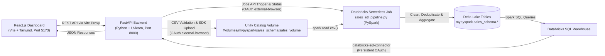
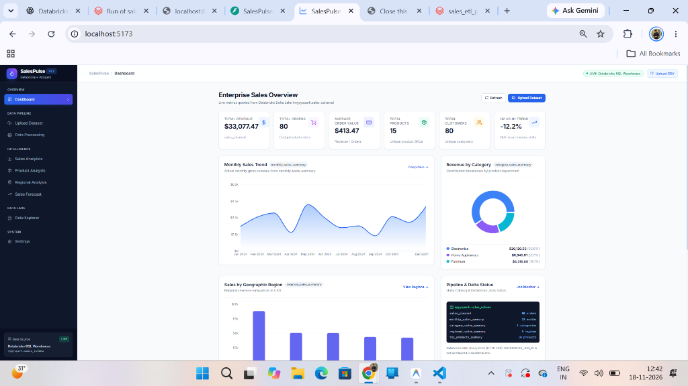
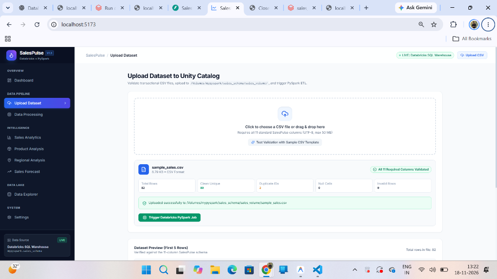

# SalesPulse – Sales Analytics & Forecasting Platform

An end-to-end **Data Engineering + Full-Stack Analytics** platform built with **Databricks, PySpark, Delta Lake, Unity Catalog, FastAPI, and React.js**.

---

## Project Highlights

* **True Cloud Data Engineering Pipeline:** Raw CSV ingestion into Unity Catalog Volumes $\rightarrow$ distributed PySpark cleaning & deduplication $\rightarrow$ 5 ACID Delta Lake tables (`mypyspark.sales_schema`) $\rightarrow$ live Databricks SQL Warehouse analytics.
* **OAuth-First Security (Zero Hardcoded Secrets):** Uses Databricks OAuth end-to-end — `databricks-oauth` with thread-safe persistent token caching for SQL Warehouse queries and `external-browser` OAuth via the Databricks SDK for Unity Catalog Volume uploads and Jobs API execution (with optional PAT fallback via `DATABRICKS_TOKEN`).
* **Real-Time Job Orchestration:** Trigger the Serverless Databricks PySpark Job directly from the React dashboard, track live `PENDING` $\rightarrow$ `RUNNING` $\rightarrow$ `SUCCESS` / `FAILED` transitions, inspect real task logs, and browse recent run history.
* **9-Page Interactive BI Dashboard:** Executive KPIs (`$33,077.47` revenue, `80` deduplicated orders, `$413.47` AOV), interactive Recharts visualizations, explainable 3-month sales forecasting, 11-column CSV validation, and a live SQL-paginated Delta Lake Data Explorer.

---

## GitHub Topics & Keywords

`databricks` &bull; `pyspark` &bull; `delta-lake` &bull; `unity-catalog` &bull; `data-engineering` &bull; `etl-pipeline` &bull; `spark-sql` &bull; `fastapi` &bull; `python` &bull; `react` &bull; `vite` &bull; `tailwindcss` &bull; `recharts` &bull; `sales-analytics` &bull; `sales-forecasting`

---

## 1. System Architecture



---

## 2. Technology Stack

| Layer | Technologies |
| :--- | :--- |
| **Frontend** | React 18, Vite (Port `5173`), Tailwind CSS, Recharts, Lucide React, Axios |
| **Backend** | Python 3.11, FastAPI, Uvicorn (Port `8000`), Pydantic, Pandas (CSV validation) |
| **Data Engineering** | Databricks, PySpark, Spark SQL, Delta Lake, Unity Catalog, Volumes, Jobs API, Serverless SQL Warehouse |
| **Connectors & Auth** | `databricks-sql-connector` (`databricks-oauth`), `databricks-sdk` (`external-browser` OAuth + optional PAT fallback), `python-dotenv` |

---

## 3. PySpark ETL Workflow Explanation

The ETL pipeline ([`databricks/notebooks/sales_etl_pipeline.py`](databricks/notebooks/sales_etl_pipeline.py)) executes in 5 clear stages inside Databricks:

1. **Ingestion (Unity Catalog Volume):** Reads the uploaded CSV (`/Volumes/mypyspark/sales_schema/sales_volume/sample_sales.csv`) using an explicit PySpark `StructType` schema (`spark.read.option("header", "true").schema(sales_schema).csv(...)`).
2. **Data Profiling:** Inspects input volume (`82` raw rows), schema (`printSchema()`), sample rows (`show()`), and numeric summaries (`describe()`).
3. **Cleaning & Quality Validation (Silver Layer):**
   * Deduplicates records by primary key using `dropDuplicates(["order_id"])` (removes `2` duplicate orders: `82` $\rightarrow$ `80` clean rows).
   * Validates dates with `to_date(col("order_date"), "yyyy-MM-dd")`, filters out null keys or non-positive quantities/prices, reconciles `sales_amount`, extracts `year` and `month`, and writes **`mypyspark.sales_schema.sales_cleaned`**.
4. **Business Aggregations (Gold Layer):** Computes grouped Spark aggregations (`groupBy()`, `agg()`, `Window` ranking) and commits 4 summary Delta tables:
   * `monthly_sales_summary` (`12` rows: `year`, `month`, `total_revenue`)
   * `category_sales_summary` (`3` rows: `category`, `revenue`)
   * `regional_sales_summary` (`5` rows: `region`, `revenue`)
   * `top_products_summary` (`10` rows: `product_name`, `revenue`)
5. **Serving via SQL Warehouse:** FastAPI executes single-round-trip Spark SQL queries against these 5 Delta tables and streams live JSON responses to the React dashboard.

---

## 4. Project Folder Structure

```
SalesPulse-Sales-Analytics-ETL-Pipeline/
├── frontend/                              # React + Vite Dashboard (Port 5173)
│   ├── src/
│   │   ├── components/
│   │   │   ├── KPICard.jsx                # Reusable KPI summary card
│   │   │   ├── ChartCard.jsx              # Reusable chart wrapper
│   │   │   ├── StatusBadge.jsx            # Job status badge (PENDING/RUNNING/SUCCESS/FAILED)
│   │   │   └── ErrorBanner.jsx            # Truthful error banner with Retry & Demo option
│   │   ├── layouts/
│   │   │   └── MainLayout.jsx             # Dark navy sidebar & LIVE/DEMO/OFFLINE header
│   │   ├── pages/
│   │   │   ├── DashboardPage.jsx          # 6 KPIs, trends, category/region charts, top SKUs
│   │   │   ├── UploadPage.jsx             # 11-column CSV validation, Volume upload & Job trigger
│   │   │   ├── DataProcessingPage.jsx     # Live Databricks Jobs API monitor, logs & auto-polling
│   │   │   ├── SalesAnalyticsPage.jsx     # Interactive H1/H2, category & metric charts
│   │   │   ├── ProductAnalysisPage.jsx    # Top-10 SKU rankings & search
│   │   │   ├── RegionalAnalysisPage.jsx   # Regional revenue, AOV & market share matrix
│   │   │   ├── SalesForecastPage.jsx      # Explainable 3-month Moving Avg + Linear Trend
│   │   │   ├── DataExplorerPage.jsx       # Live SQL-paginated, searchable Delta Lake table
│   │   │   └── SettingsPage.jsx           # Non-secret config status & Live/Demo toggle
│   │   ├── services/
│   │   │   ├── api.js                     # Unified Axios client (Live Databricks + explicit Demo)
│   │   │   ├── analytics.js               # Convenience re-exports of analytics functions
│   │   │   └── sampleData.js              # Verified sample CSV metrics for offline Demo Mode
│   │   └── utils/formatters.js            # Currency, number & date formatters
│   ├── index.html
│   ├── package.json
│   ├── package-lock.json
│   ├── postcss.config.js
│   ├── tailwind.config.js
│   └── vite.config.js                     # Port 5173 + /api proxy -> http://127.0.0.1:8000
│
├── backend/                               # FastAPI Backend (Port 8000)
│   ├── app/
│   │   ├── config/settings.py             # Resolves backend/.env reliably (never exposes secrets)
│   │   ├── schemas/sales.py               # Pydantic request & response schemas
│   │   ├── services/
│   │   │   ├── databricks_service.py      # Persistent SQL OAuth + SDK external-browser OAuth/PAT
│   │   │   ├── etl_validator.py           # 11-column CSV schema, duplicate, date & numeric checks
│   │   │   ├── forecast_service.py        # 3-Month Moving Average + OLS Linear Trend math
│   │   │   └── demo_service.py            # Explicit ?mode=demo stats from data/sample_sales.csv
│   │   ├── routes/
│   │   │   ├── analytics.py               # /dashboard/summary, /analytics/*, /forecast, /data
│   │   │   ├── upload.py                  # /upload/validate, /upload
│   │   │   └── jobs.py                    # /process, /jobs, /jobs/{run_id}
│   │   └── main.py                        # FastAPI app, CORS, lifespan, /api/health, /api/config/status
│   ├── test_local.py                      # Automated local unit & live HTTP test suite
│   ├── requirements.txt
│   └── .env.example                       # Sanitized environment template (no real secrets)
│
├── databricks/
│   ├── notebooks/
│   │   ├── sales_etl_pipeline.py          # PySpark ETL notebook
│   │   └── sales_analytics.sql            # Spark SQL verification & BI queries
│   └── README.md                          # Databricks, Unity Catalog & OAuth setup guide
│
├── data/
│   └── sample_sales.csv                   # 82 raw rows (80 unique + 2 duplicate orders)
│
├── docs/
│   └── screenshots/                       # 8 live Databricks dashboard screenshots
│       ├── 01_dashboard.png
│       ├── 02_sales_analytics.png
│       ├── 03_product_analysis.png
│       ├── 04_regional_analysis.png
│       ├── 05_sales_forecast.png
│       ├── 06_data_explorer.png
│       ├── 07_upload_dataset.png
│       └── 08_data_processing.png
│
├── SALESPULSE_COMPLETION_REPORT.md        # Detailed implementation, root-cause & test report
├── .gitignore                             # Excludes .env, OAuth token caches, venv, node_modules, dist
└── README.md
```

---

## 5. Unity Catalog Delta Lake Tables (`mypyspark.sales_schema`)

| Table Name | Layer | Verified Rows (Sample CSV) | Purpose |
| :--- | :---: | :---: | :--- |
| `sales_cleaned` | Silver | `80` | Deduplicated, schema-validated transactional orders (`2` duplicates removed from `82` raw rows) |
| `monthly_sales_summary` | Gold | `12` | Monthly revenue timeline (`year`, `month`, `total_revenue`) |
| `category_sales_summary` | Gold | `3` | Revenue by product category (`category`, `revenue`) |
| `regional_sales_summary` | Gold | `5` | Regional revenue comparison (`region`, `revenue`) |
| `top_products_summary` | Gold | `10` | Top 10 revenue-generating products (`product_name`, `revenue`) |

---

## 6. Environment Configuration & Authentication (`backend/.env`)

Copy `backend/.env.example` to `backend/.env` and fill in your workspace details (**never commit `backend/.env`**):

```env
DATABRICKS_SERVER_HOSTNAME=your-workspace-id.cloud.databricks.com
DATABRICKS_HOST=https://your-workspace-id.cloud.databricks.com
DATABRICKS_WAREHOUSE_ID=your_sql_warehouse_id
DATABRICKS_HTTP_PATH=/sql/1.0/warehouses/your_sql_warehouse_id

# Authentication (OAuth-First with Optional PAT Fallback):
# - Leave DATABRICKS_TOKEN empty to use browser OAuth for ALL features:
#     1) SQL Warehouse queries (`databricks-oauth`)
#     2) Unity Catalog Volume uploads & Jobs API (`external-browser` via Databricks SDK)
# - Or optionally set DATABRICKS_TOKEN=dapi... for non-interactive PAT authentication.
DATABRICKS_TOKEN=

# Numeric Databricks Job ID for your sales_etl_pipeline Job
DATABRICKS_JOB_ID=your_numeric_job_id

DATABRICKS_CATALOG=mypyspark
DATABRICKS_SCHEMA=sales_schema
DATABRICKS_VOLUME=sales_volume

PORT=8000
ENVIRONMENT=development
```

> **How `.env` loading works:** [`backend/app/config/settings.py`](backend/app/config/settings.py) resolves `backend/.env` using an absolute path (`Path(__file__).resolve().parents[2] / ".env"`), so it loads reliably from any working directory. After editing `backend/.env`, restart `uvicorn` and confirm `GET http://localhost:8000/api/health` reports `sql_warehouse_connected: true`, `job_id_configured: true`, and `jobs_api_ready: true`.

See [`databricks/README.md`](databricks/README.md) for detailed Databricks workspace setup steps.

---

## 7. Running Locally on Windows (VS Code PowerShell)

### Step 1: Start Databricks SQL Warehouse
In Databricks $\rightarrow$ **SQL Warehouses** $\rightarrow$ **Serverless Starter Warehouse** $\rightarrow$ click **▶ Start**.

### Step 2: Run FastAPI Backend (Terminal 1 — Port `8000`)
```powershell
cd backend
python -m venv venv
.\venv\Scripts\Activate.ps1
pip install -r requirements.txt
uvicorn app.main:app --reload --port 8000
```
* **API Root:** `http://127.0.0.1:8000`
* **Swagger Docs:** `http://127.0.0.1:8000/docs`
* **Health Diagnostics:** `http://127.0.0.1:8000/api/health`

*(When using OAuth without a PAT, Chrome opens one sign-in tab on the first SQL query and one sign-in tab on the first Jobs/Upload call; tokens are cached locally in git-ignored files so subsequent requests require zero extra popups.)*

### Step 3: Run React Frontend (Terminal 2 — Port `5173`)
```powershell
cd frontend
npm install
npm run dev
```
* **Dashboard URL:** `http://localhost:5173`

---

## 8. API Endpoints Reference

| Method | Endpoint | Auth Used | Description |
| :--- | :--- | :---: | :--- |
| `GET` | `/` | None | Backend metadata & target Unity Catalog schema |
| `GET` | `/api/health` | SQL OAuth / PAT | Separate health diagnostics for SQL Warehouse, Jobs API auth mode & Job ID |
| `GET` | `/api/config/status` | None | Non-secret Databricks configuration for the Settings page |
| `GET` | `/api/dashboard/summary` | SQL OAuth / PAT | Executive KPIs (`sales_cleaned`) |
| `GET` | `/api/analytics/monthly-sales` | SQL OAuth / PAT | Monthly revenue & order trend (`monthly_sales_summary`) |
| `GET` | `/api/analytics/category-sales` | SQL OAuth / PAT | Category revenue & share (`category_sales_summary`) |
| `GET` | `/api/analytics/regional-sales` | SQL OAuth / PAT | Regional revenue & AOV (`regional_sales_summary`) |
| `GET` | `/api/analytics/top-products` | SQL OAuth / PAT | Top 10 ranked products (`top_products_summary`) |
| `GET` | `/api/forecast` | SQL OAuth / PAT | Explainable 3-month forecast computed from live `monthly_sales_summary` |
| `GET` | `/api/data` | SQL OAuth / PAT | Live SQL-paginated, searchable, filtered rows from `sales_cleaned` |
| `POST` | `/api/upload/validate` | None | Validates CSV schema, duplicates, nulls, dates & numerics locally |
| `POST` | `/api/upload` | SDK OAuth / PAT | Validates CSV and uploads to Unity Catalog Volume (`sales_volume`) |
| `POST` | `/api/process` | SDK OAuth / PAT | Triggers the configured Databricks PySpark Job (`DATABRICKS_JOB_ID`) |
| `GET` | `/api/jobs` | SDK OAuth / PAT | Lists recent genuine Databricks Job runs |
| `GET` | `/api/jobs/{run_id}` | SDK OAuth / PAT | Retrieves live status (`PENDING`/`RUNNING`/`SUCCESS`/`FAILED`), timing & task logs |

*(All read-only analytics endpoints also accept `?mode=demo` for explicit offline preview computed from `data/sample_sales.csv`.)*

---

## 9. CSV Upload Requirements

Uploaded `.csv` files (max 50 MB) must contain these 11 required columns:
`order_id`, `order_date`, `customer_id`, `customer_name`, `product_id`, `product_name`, `category`, `region`, `quantity`, `unit_price`, `sales_amount`.

---

## 10. Forecast Methodology & Limitations

* **Method:** 3-Month Moving Average + Simple Linear Trend (Ordinary Least Squares slope) computed dynamically from actual historical monthly revenue (`monthly_sales_summary`).
* **Uncertainty Band:** Illustrative $\pm 1$ historical monthly standard deviation (no fabricated confidence percentages).
* **Limitations:** With 12 monthly observations, complex ML models (ARIMA/Prophet) would overfit. Forecasts are illustrative estimates only and do not guarantee future performance or account for promotions, supply shocks, or external market shifts.

---

## 11. Local Testing & Verification

Run the automated backend test suite (PySpark notebook syntax, CSV validator, forecast math, 6-thread OAuth single-flight concurrency test, and live HTTP endpoint checks):
```powershell
cd backend
.\venv\Scripts\python.exe test_local.py
```

Build the frontend production bundle:
```powershell
cd frontend
npm run build
```

---

## 12. Screenshots (Live Databricks SQL Warehouse & Jobs API)

### 1. Executive Dashboard (LIVE Databricks KPIs, Trends & Delta Lake Status)


### 2. Interactive Sales Analytics


### 3. Product Portfolio & Top-10 SKU Analysis


### 4. Geographic & Regional Performance


### 5. Sales Forecasting & 3-Month Projections


### 6. Delta Lake Data Explorer (Paginated `sales_cleaned`)


### 7. Dataset Upload (Live Unity Catalog Volume Upload + 11-Column Validation)


### 8. Databricks PySpark Job Monitor (Live Jobs API Run `SUCCESS` & Task Logs)


---

## 13. Known Limitations

1. **Interactive OAuth on Local Machine:** Default OAuth authentication (`databricks-oauth` for SQL Warehouse and `external-browser` for Volume uploads & Jobs API) opens a one-time browser login tab per scope on first run. For headless/CI servers without a browser, configure the optional `DATABRICKS_TOKEN` PAT fallback in `backend/.env`.
2. **Cold Serverless Warehouse Wake-Up:** A stopped Serverless Starter Warehouse takes several seconds to start on the very first query; subsequent queries complete in ~0.5–1.5s.
3. **Small Historical Dataset:** The sample dataset contains 12 months (`80` deduplicated orders), so forecasting intentionally uses a transparent statistical baseline rather than complex ML models.
